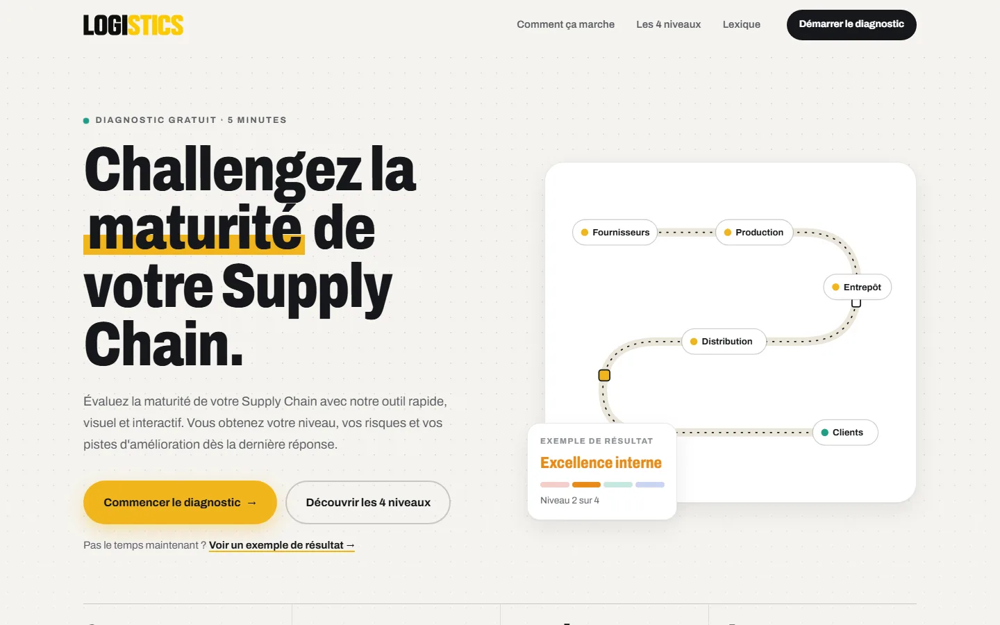

<div align="center">

# 📦 Diagnostic Supply Chain

**Un quiz interactif pour évaluer la maturité de la Supply Chain d'une entreprise, en 27 questions et 5 minutes.**

Conçu lors de mon stage dans une entreprise de logistique (mai – juin 2025), puis entièrement repensé : UI/UX, passage à React, API, base de données et espace admin.


<a href="https://danidois2002.github.io/diagnostic-supply-chain/"></a>

🔗 **[danidois2002.github.io/diagnostic-supply-chain](https://danidois2002.github.io/diagnostic-supply-chain/)** · [Voir un exemple de résultat](https://danidois2002.github.io/diagnostic-supply-chain/#/exemple) · [Espace admin](https://danidois2002.github.io/diagnostic-supply-chain/#/admin) (compte démo : `demo` / `diagnostic`)

<a href="https://danidois2002.github.io/diagnostic-supply-chain/"></a>

</div>

---

## ✨ Le parcours

1. **Accueil** : présentation du diagnostic, des 4 niveaux de maturité, des 7 thématiques et d'un lexique Supply Chain.
2. **Informations** : nom de l'entreprise et fonction ; e-mail et téléphone facultatifs. Une case permet d'**enregistrer le diagnostic**.
3. **27 affirmations en 7 thématiques** : réponse « Pas du tout », « En cours » ou « Mis en place ». Les termes techniques sont soulignés et leur définition s'ouvre d'un clic.
4. **Résultat** :
   - le niveau de maturité et un score sur 100, sur une échelle à 4 niveaux ;
   - la progression par niveau : points acquis, niveaux validés ou en attente ;
   - le degré de mise en place par thématique, comparé à la moyenne des entreprises ;
   - **la position par rapport aux autres entreprises** (« 62 % des entreprises ont un score inférieur au vôtre ») ;
   - un **lien partageable** si le diagnostic est enregistré ;
   - la définition du niveau obtenu, les risques identifiés et un rapport à télécharger en PDF.

Un lien **« Voir un exemple de résultat »** affiche directement une page de résultats avec des réponses fictives.

## 📊 Espace admin

Accessible depuis le pied de page (`#/admin`), l'équivalent du fichier Excel de la version d'origine, en mieux :

- **indicateurs** : nombre de diagnostics, activité des 30 derniers jours, score moyen, diagnostics avec coordonnées ;
- **graphique des diagnostics par jour**, avec info-bulle au survol comme au clavier et tableau des données ;
- **niveaux atteints**, **mise en place moyenne par thématique** et **les 5 pratiques les moins mises en place** : les pistes d'accompagnement les plus utiles ;
- **liste des diagnostics** : recherche, filtre par niveau, pagination, lien vers chaque résultat et suppression ;
- **export CSV pour Excel** (séparateur « ; », accents conservés, formules neutralisées) ;
- un filtre pour **inclure ou non les diagnostics simulés**.

Deux comptes :

| Compte | Accès |
|---|---|
| `admin` (mot de passe privé, défini sur l'hébergeur) | tout, y compris les coordonnées, la recherche et la suppression |
| `demo` / `diagnostic` (public) | lecture seule : les coordonnées sont **masquées par le serveur** (« j•••@a•••.be »), jamais envoyées au navigateur |

## 🧮 Calcul du niveau

Le niveau suit un **modèle en escalier**, comme les modèles de maturité classiques :

| Niveau | Questions qui le valident | Points |
|---|---|---|
| 1 · Supply Chain Fragmentée | point de départ | — |
| 2 · Excellence interne | 18 questions | 36 |
| 3 · Intégration | 7 questions | 14 |
| 4 · Supply Chain Collaborative | 2 questions | 4 |

- Chaque réponse rapporte des points : « Pas du tout » = 0, « En cours » = 1, « Mis en place » = 2.
- Un niveau est **validé dès que 70 % de ses points sont acquis**, et seulement si les niveaux précédents le sont aussi : on ne saute pas d'étape.
- Le **score de maturité** (0 à 100) suit la même échelle : 25 points par niveau validé, plus la progression vers le niveau suivant.

« Mis en place » partout donne donc le niveau 4 et 100/100.

Le calcul est dans [`shared/scoring.js`](shared/scoring.js), **partagé par le site et l'API** : le serveur recalcule lui-même chaque résultat enregistré, on ne peut pas le truquer depuis le navigateur. Il est vérifié par des tests automatiques ([`scoring.test.js`](shared/scoring.test.js)).

> [!NOTE]
> La version d'origine faisait la moyenne des niveaux associés à chaque réponse. Comme 17 questions sur 27 plafonnaient au niveau 2, même « Mis en place » partout donnait le niveau 2 : les niveaux 3 et 4 étaient impossibles à atteindre.

## 🏗️ Architecture

```
Navigateur (React + Vite)   ──►   API Node.js + Express   ──►   PostgreSQL
GitHub Pages                      Render                         Neon
            └──────────── shared/ : questionnaire et calcul du score ────────────┘
```

Le site reste utilisable sans l'API : si le serveur ne répond pas, le résultat s'affiche depuis le navigateur, avec un bouton pour réessayer l'enregistrement.

### API

| Méthode | Route | Rôle |
|---|---|---|
| `POST` | `/api/diagnostics` | Enregistre un diagnostic (avec accord explicite) ; le serveur recalcule le niveau et le score |
| `GET` | `/api/diagnostics/:id` | Relit un diagnostic par son lien : réponses, résultat et nom de l'entreprise, **jamais** l'e-mail, le téléphone ni la fonction |
| `GET` | `/api/stats` | Statistiques anonymes : répartition des scores et des niveaux, moyenne par thématique |
| `GET` | `/api/health` | État du service |
| `POST` | `/api/auth/login` | Connexion à l'espace admin : renvoie un jeton JWT (8 h) |
| `GET` | `/api/admin/summary` | Indicateurs et statistiques du tableau de bord |
| `GET` | `/api/admin/diagnostics` | Liste paginée, filtres par niveau et recherche (admin) |
| `DELETE` | `/api/admin/diagnostics/:id` | Suppression (admin uniquement) |
| `GET` | `/api/admin/export.csv` | Export CSV pour Excel |

- **Express 5**, validation des données avec **Zod**, en-têtes de sécurité avec **Helmet**, **CORS** limité au site, **limites anti-abus** par adresse IP (enregistrements, connexions, requêtes).
- **Sessions JWT** ; mots de passe comparés en temps constant ; rôles admin et démo vérifiés par le serveur sur chaque route.
- **PostgreSQL** via `pg` en production (Neon), **PGlite** (PostgreSQL en WebAssembly) en local et pour les tests : rien à installer.
- **32 tests d'API** (`node:test` + Supertest) sur une vraie base, lancés par GitHub Actions.

### Données et confidentialité

- Rien n'est envoyé sans la case cochée (ou le bouton « Enregistrer mon diagnostic » sur la page de résultats).
- Identifiants de lien aléatoires (12 caractères), impossibles à deviner.
- **Après 30 jours, les coordonnées sont effacées** automatiquement : il ne reste que des réponses anonymes, qui servent aux statistiques.
- Pour que la comparaison ait du sens dès le départ, la base contient **40 diagnostics simulés**, signalés comme tels sur la page de résultats.

## 🛠️ Côté site

- **React 19 + Vite**, en JavaScript, avec **React Router** (`#/diagnostic`, `#/resultats`, `#/resultats/:id`, `#/exemple`).
- **État partagé** par contexte React : le diagnostic en cours et la fenêtre de détail (termes du lexique, niveaux).
- **Progression sauvegardée** dans le navigateur (`localStorage`) : on peut fermer l'onglet et reprendre plus tard.
- **Rapport PDF** généré par une feuille de style d'impression dédiée.
- **Accessibilité** : navigation au clavier, fenêtres `<dialog>` natives, réglage « réduire les animations » respecté, couleurs des niveaux validées pour le daltonisme.
- **Déploiement continu** : chaque push sur `main` lance les tests, construit le site et le publie sur GitHub Pages ; l'API se redéploie sur Render quand `api/` ou `shared/` change.

> [!NOTE]
> La version d'origine, réalisée pendant le stage, est en PHP : elle enregistre chaque diagnostic dans un fichier Excel (PhpSpreadsheet), le dépose sur SharePoint et envoie le rapport PDF par e-mail (mPDF, PHPMailer).

## 🗺️ Feuille de route

- [x] **Passage à React + Vite**, avec un rendu identique à la version précédente
- [x] **Nouveau calcul du niveau**, en escalier comme les modèles de maturité : le niveau 4 est atteignable
- [x] **API Node.js + PostgreSQL** : enregistrement des diagnostics, lien de résultat partageable, comparaison avec les autres entreprises
- [x] **Espace admin** : tableau de bord, statistiques, liste des diagnostics, export CSV et compte de démonstration

## 🚀 Lancer en local

```bash
# 1. L'API (base PostgreSQL en mémoire grâce à PGlite)
cd api
npm install
npm run dev

# 2. Le site, dans un autre terminal
npm install
npm run dev
```

Puis ouvrez [localhost:5173/diagnostic-supply-chain/](http://localhost:5173/diagnostic-supply-chain/) : en local, le site appelle l'API sur `localhost:3000`. Les réglages de l'API sont décrits dans [`api/.env.example`](api/.env.example).

- `npm test` : tests du calcul ; `cd api && npm test` : tests de l'API.
- `npm run build` : version de production du site dans `dist/`.

## ☁️ Mise en ligne de l'API

1. Créer une base PostgreSQL sur [Neon](https://neon.tech) et copier son URL de connexion.
2. Sur [Render](https://render.com) : **New → Blueprint**, choisir ce dépôt ([`render.yaml`](render.yaml)) et coller l'URL dans `DATABASE_URL`.
3. Dans **Environment**, définir `ADMIN_PASSWORD` (le mot de passe du compte `admin`). `JWT_SECRET` est généré par Render.

Au premier démarrage, l'API crée ses tables et les diagnostics simulés. L'hébergement gratuit met l'API en veille : le premier appel peut prendre une trentaine de secondes, et le site l'indique.

## 📁 Structure

```
├── index.html                # page HTML de base (Vite)
├── src/                      # le site React
│   ├── App.jsx               # les routes
│   ├── styles.css            # le design et le rapport imprimable
│   ├── lib/                  # client de l'API, formats
│   ├── state/                # contextes : diagnostic en cours, fenêtre de détail
│   ├── components/           # mise en page, partage, comparaison, petits composants
│   └── pages/                # Accueil, Diagnostic, Résultats, Espace admin
├── shared/                   # partagé par le site et l'API
│   ├── data.js               # le contenu : niveaux, thématiques, questions, lexique
│   └── scoring.js            # le calcul du niveau et du score (et ses tests)
├── api/                      # l'API Node.js + Express
│   ├── src/                  # serveur, routes, connexion, masquage, base de données
│   ├── db/schema.sql         # le schéma PostgreSQL
│   └── test/                 # les tests de l'API
├── public/img/               # le logo et les illustrations des 4 niveaux
├── render.yaml               # déploiement de l'API sur Render
└── .github/workflows/        # tests, construction et publication
```

---

<div align="center">

Réalisé par **Danial Bitar** · [GitHub](https://github.com/Danidois2002) · [LinkedIn](https://www.linkedin.com/in/daniel-bitar-992ab3258)

</div>
